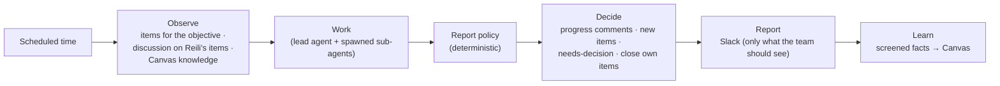

# Objective-driven autonomy

Reili can pursue long-term objectives on its own. It works on the team's tracker the way a
teammate does: on its schedule it picks up the items assigned to it, does read-only work that
moves the objective forward, writes progress as comments, opens items for new work, asks the
team when a decision is needed, and reports what matters to Slack.

The existing Slack-triggered, single-shot investigations keep working unchanged.

- Objectives live in `reili.toml` (*what* to pursue).
- Work lives on the team's tracker as ordinary issues (GitHub Issues today; see
  [Work State backends](#work-state-backends)). An objective's progress is the set of items
  labelled for it; Reili's own work is the subset assigned to it.
- Knowledge lives in the Slack Canvas memory (reusable facts).
- Nothing else is persisted: no database, no state issue, no hidden state store.

## Contents

- [Configuring objectives](#configuring-objectives)
- [How Reili works with the team](#how-reili-works-with-the-team)
- [The cycle](#the-cycle)
- [Work State backends](#work-state-backends)
- [GitHub Issues](#github-issues)
- [What is and is not guaranteed](#what-is-and-is-not-guaranteed)
- [Report policy](#report-policy)
- [Safety, permissions, and limits](#safety-permissions-and-limits)
- [Operations runbook](#operations-runbook)
- [Known limitations](#known-limitations)

## Configuring objectives

```toml
# Required when [[objectives]] are configured: exactly one [work_state.<backend>] section.
# Supported backends: github. The repository the team tracks its work in.
[work_state.github]
repository = "acme/platform"
# Optional: App credentials default to [connector.github.app]. Tokens are always down-scoped to
# this repository with issues:write + metadata:read, whatever the installation itself allows.
# app_id = "123456"
# installation_id = "12345678"
# private_key_env = "GITHUB_WORK_STATE_APP_PRIVATE_KEY"
# api_base_url = "https://api.github.com"   # GitHub Enterprise Server: https://HOST/api/v3
# web_base_url = "https://github.com"

# Optional: scheduler settings (defaults shown).
[autonomy]
tick_interval_seconds = 60   # how often schedules are checked
max_concurrent_cycles = 1    # cycles running at once across objectives

[[objectives]]
id = "checkout-reliability"           # 1-34 chars: a-z 0-9 - _
description = """
Continuously improve checkout service reliability.
Identify recurring failures, investigate root causes,
and recommend measurable improvements.
"""
scope = ["checkout-api"]              # services
repositories = ["acme/checkout"]      # optional
environments = ["production"]         # optional
schedule = "0 */6 * * *"              # 5-field cron; @hourly/@daily/@weekly/@monthly too
timezone = "Asia/Tokyo"               # IANA name; defaults to UTC
report_channel = "C0123456789"        # Slack channel ID (not name)
enabled = true

[objectives.budget]                        # optional; defaults shown
max_cycle_minutes = 30
max_llm_tokens_per_cycle = 2000000
max_tool_calls_per_cycle = 200
max_new_work_items_per_cycle = 3

[objectives.permissions]                   # optional; can only narrow what is already allowed
save_knowledge = true                 # write screened facts to the Canvas memory
post_reports = true                   # post reports to report_channel
```

Startup fails with a clear message for invalid cron expressions, unknown time zones, channel
names instead of IDs, duplicate objective IDs, empty budgets, or objectives without a
`[work_state.<backend>]` section. Cycles run only on the schedule, so the budget per cycle also
bounds the daily cost.

Editing, disabling (`enabled = false`), or removing an objective takes effect on restart. Its
items stay on the tracker as they are; Reili simply stops (or resumes) working on them.

## How Reili works with the team

Everything happens on the tracker, with the same tools the team already uses:

| On GitHub | Meaning |
|---|---|
| Label `reili-objective:<id>` | The item belongs to that objective. Filter by it to see the objective's progress. |
| Label `reili:assignee` | The item is assigned to Reili (labels stand in for assignees, which GitHub Apps cannot reliably be). |
| Label `reili:needs-decision` | Reili is waiting for the team's decision; the question is in its last comment. |

| The team does | Reili does at its next scheduled time |
|---|---|
| Adds `reili:assignee` (and the objective label) to an item | Takes it on: reads the description and discussion and works on it |
| Removes `reili:assignee` | Stops working on it and does not open a duplicate |
| Comments (owners, members, collaborators) | Reads the comments that arrived since its last comment and acts on them |
| Closes an item as not planned | Does not reopen or re-propose it without new evidence |
| Closes an item as completed | Treats it as done; opens a follow-up only if the problem comes back |

Reili, in turn:

- writes a **progress comment** on each of its items it worked on in a cycle (what it did, what it
  found with evidence links, hypotheses, recommendation, next steps);
- **opens a new item** for new work, labelled for the objective and assigned to itself, with a
  readable description (problem, findings, evidence) and hidden metadata (its de-duplication key);
- adds `reili:needs-decision` with a concrete question when it needs the team, and removes it when
  it continues;
- **closes items it opened** when they are done; for items a teammate opened it says it considers
  them done and leaves closing to the team.

Reili never edits the description of an item after opening it and never removes labels other than
its own needs-decision label.

## The cycle

Each cycle runs Observe → Work → Decide → Report → Learn. The cycle does not assume what kind of
work the agent does: investigating a signal, reviewing recent changes, checking whether an earlier
recommendation took effect, following up on its items, or preparing a proposal all go through the
same phases, as long as the work is read-only.



- **Observe** (no LLM): lists the objective's items (all open ones and those closed in the last
  30 days), reads the discussion on Reili's own open items (up to 15, most recently updated
  first), and loads Canvas memories.
- **Work** (LLM): the lead agent receives a brief: the objective; its items with their
  description and recent trusted comments, new ones marked `NEW`; other open items it must leave
  alone; recently closed items; and knowledge. It chooses the work that moves the objective
  forward most, does it with sub-agents composed from the connector catalog (`spawn_agent`), and
  ends by calling `submit_cycle_report` with a structured report.
- **Decide** (no LLM): the report policy screens the report (below). Proposals continue an item
  when they name it (`existing_record`) or share its key; items assigned away from Reili and items
  closed as not planned are left alone; new items are limited per cycle (most severe first).
- **Report** (no LLM): posts to Slack only when the team should look at something: new items,
  decisions needed, items done. Routine progress stays on the items.
- **Learn** (no LLM): persists screened knowledge drafts to the Canvas, at most five per cycle,
  never a fact the Canvas already holds.

"No new findings" is a normal, quiet outcome: nothing is written, nothing is posted.

## Work State backends

The cycle talks to the tracker only through the `WorkStatePort` trait
(`crates/core/src/work/port.rs`), so the tracker is a configuration choice. Items are identified by
the key humans already use (`#12` on GitHub; a JIRA backend would use keys such as `OPS-123`) plus
a URL.

| Backend | Section | Status |
|---|---|---|
| GitHub Issues | `[work_state.github]` | Supported |

A backend must provide, inside one configured project:

- an objective label, an assignee label for Reili, and a needs-decision label (a JIRA backend
  could map them to labels, a component, or a service-account assignee);
- listing by objective label **in creation order** from a strongly consistent API (the oldest item
  wins when racing creates are collapsed);
- hidden metadata on the items Reili opens (its de-duplication key);
- comments, with detection of Reili's own comments and of trusted authors;
- refusal of any item outside the configured project.

Adding a backend means implementing the port in `crates/adapters`, adding its
`[work_state.<backend>]` section and a `WorkStateConfig` variant in `crates/runtime/src/config`,
and one arm in `build_work_state` (`crates/runtime/src/bootstrap/objectives.rs`). The application
layer does not change. The contract is executable: `assert_work_state_contract`
(`crates/core/src/work/conformance.rs`) runs against the in-memory fake and, over HTTP, against
the GitHub backend; a new backend passes it with a small harness that can act as a teammate (open
an item, comment, assign or unassign Reili).

## GitHub Issues

- Reads use the issue *listing* API filtered by labels (strongly consistent), never search, whose
  index lags behind writes.
- Labels are added and removed with the per-label endpoints, so labels the team sets are never
  overwritten.
- Reili recognises its own issues and comments by the App's bot account plus a hidden marker; a
  marker copied into someone else's issue or comment is not trusted.
- Comments count as team input only from repository owners, members, and collaborators; other
  authors and other bots never reach the agent.
- Text Reili writes holds references (URLs, queries, time windows), never raw logs, and passes
  through secret redaction (tokens, keys, private keys, bearer values, `password=…`, emails) and
  size limits.

## What is and is not guaranteed

- **No state to lose.** A cycle that dies halfway leaves the comments it already wrote; the next
  scheduled time starts again from the tracker.
- **Scheduling.** Cycles run at the scheduled times only. A time that passes while Reili is
  stopped, or while the objective's previous cycle is still running, is skipped; the next one
  picks the work up. Several times missed between two checks collapse into one cycle.
- **No duplicates.** After opening an item Reili lists the objective's items again and, if an
  older open item with the same key exists (another instance opened it at the same time), closes
  its own as a duplicate pointing to the older one.
- **Slack report idempotency.** Reports carry a key per objective and scheduled time in Slack
  message metadata; before posting, Reili checks recent channel history for that key.
- **Tracker unavailable.** Nothing runs without a readable tracker; the cycle stops before the
  agent runs and the next scheduled time tries again.

**Not guaranteed:** exactly-once work. A cycle that crashes after commenting and is followed by a
later cycle may comment on the same topic again. Without `channels:history`, a re-run of the same
scheduled time can repeat a Slack report once.

## Report policy

The model's report is screened by application code before anything is written:

- hypothesis statuses (`proposed`, `supported`, `refuted`, `inconclusive`) are the agent's own
  assessment and are written as reported, with their cited evidence;
- citations to evidence ids that are not in the report's `evidence` list are dropped;
- `resolved` needs a finding that cites evidence and `needs_decision` a concrete question;
  otherwise the item stays in progress;
- every adjustment is noted in the item's progress comment;
- knowledge candidates reach the Canvas only when they cite evidence with a source URL and do not
  read like instructions; hypotheses and time-bounded observations are never learned.

## Safety, permissions, and limits

- **Read-only operations.** Agents get only read-only connector tools. Production changes,
  deploys, rollbacks, and monitor changes remain impossible.
- **Write exception, narrowly scoped.** Tracker writes (issues, comments, labels) go only to the
  configured repository: the installation token is requested down-scoped to that single repository
  with `issues: write` and `metadata: read`, and the adapter refuses any issue reference outside it
  before making a request. The investigation GitHub connector is unchanged and read-only. The
  model never chooses where to write; all writes are application code.
- **Budgets.** Per objective and cycle: wall-clock time, LLM tokens, tool calls, and new items.
  Tool calls beyond the budget are refused with an instruction to submit what the agent has; a
  hard stop applies at a multiple of the token budget.
- **Prompt injection.** Item text, comments, Slack excerpts, and memories are framed as
  `<untrusted_data>`; the agent is told never to follow instructions found there. Only comments
  from trusted members are passed on, and none can change permissions, budgets, or scope.
  Broadcast mentions (`@channel`, `@here`) are neutralized in reports.
- **Audit.** Every change Reili makes is visible on the tracker: its comments, the labels it sets,
  and the items it opens or closes.

## Operations runbook

**Setup**

1. Pick the repository the team tracks its work in (e.g. `acme/platform`).
2. Install the Reili GitHub App on it with repository permissions **Issues: read & write** and
   **Metadata: read** (or use a separate App and set `[work_state.github]` credentials). The
   investigation installation keeps its read-only permissions.
3. Slack: invite Reili to each `report_channel`. `chat:write` posts reports; `channels:history`
   enables report idempotency checks.
4. Add `[[objectives]]` and restart. The first cycle runs at the next scheduled time.

**Day to day**

- Filter issues by `reili-objective:<id>` to see an objective's work, and by `reili:assignee` to see
  what Reili is working on.
- Answer `reili:needs-decision` items with a comment. Hand Reili work by adding `reili:assignee`
  and the objective label; take it back by removing `reili:assignee`.
- Logs: `objective_cycle_started`, `objective_cycle_finished`, `objective_cycle_ended`,
  `objective_cycle_cancelled`, `objective_cycle_failed`, `objective_cycle_skipped`,
  `objective_proposal_skipped`, `objective_cycle_report_failed`.

**Troubleshooting**

| Symptom | Check |
|---|---|
| No cycles run | `enabled`, the schedule and time zone, `objective_cycle_failed` logs (tracker access) |
| Reili ignores an item | It needs both `reili-objective:<id>` and `reili:assignee`, and must be open |
| A comment had no effect | Only owners, members, and collaborators are read; it is read at the next scheduled time |
| Reports missing | `post_reports`, routine progress is not reported, bot not in channel, `objective_cycle_report_failed` logs |
| Write refused (`Forbidden`) | Installation not on the configured repository or missing Issues: write |

## Known limitations

- Reili does not independently check the agent's conclusions: hypothesis statuses and findings
  are the agent's assessment, backed only by the evidence it cites.
- Reili does not measure progress toward the objective or the effect of implemented
  recommendations; the team judges both and closes the items.
- Objective cycles run only on their schedule; Slack messages, alerts, and issue comments never
  start one. Comments and label changes are picked up at the next scheduled time.
- Reili works in one configured repository per deployment.
