# Goal-driven autonomy

Reili can pursue long-term goals on its own: it periodically observes the services a goal covers,
decides what to investigate, records the work as GitHub Issues, reports what matters to Slack,
and learns reusable facts into the Slack Canvas memory.

The existing Slack-triggered, single-shot investigations keep working unchanged.

- Goals live in `reili.toml` (the source of truth for *what* to pursue).
- Work State lives in GitHub Issues of one dedicated management repository (the source of truth
  for *what has been done, decided, and is pending*).
- Knowledge lives in the Slack Canvas memory (reusable facts).
- Nothing else is persisted. There is no database; process memory is only a cache.

## Contents

- [Configuring goals](#configuring-goals)
- [The cycle](#the-cycle)
- [Work State on GitHub Issues](#work-state-on-github-issues)
- [Durability and what is not guaranteed](#durability-and-what-is-not-guaranteed)
- [Report policy](#report-policy)
- [Learning](#learning)
- [Working with Reili from Slack and GitHub](#working-with-reili-from-slack-and-github)
- [Safety, permissions, and limits](#safety-permissions-and-limits)
- [Operations runbook](#operations-runbook)
- [Known limitations](#known-limitations)

## Configuring goals

```toml
# Required when [[goals]] are configured. A dedicated repository for Reili's Work State.
[work_state.github]
repository = "acme/reili-work"
# Optional: App credentials default to [connector.github.app]. Tokens are always down-scoped to
# this repository with issues:write + metadata:read, whatever the installation itself allows.
# app_id = "123456"
# installation_id = "12345678"
# private_key_env = "GITHUB_WORK_STATE_APP_PRIVATE_KEY"
# api_base_url = "https://api.github.com"   # GitHub Enterprise Server: https://HOST/api/v3
# web_base_url = "https://github.com"

# Optional: scheduler settings (defaults shown).
[autonomy]
tick_interval_seconds = 60   # how often goals are evaluated
max_concurrent_cycles = 1    # cycles running at once across goals
lease_minutes = 15           # cycle lease; renewed while the agent runs
feedback_poll_minutes = 10   # how often issues are scanned for `/reili rerun`

[[goals]]
id = "checkout-reliability"           # 1-39 chars: a-z 0-9 - _
objective = """
Continuously improve checkout service reliability.
Identify recurring failures, investigate root causes,
and recommend measurable improvements.
"""
scope = ["checkout-api"]              # services
repositories = ["acme/checkout"]      # optional
environments = ["production"]         # optional
schedule = "0 */6 * * *"              # 5-field cron; @hourly/@daily/@weekly/@monthly too
timezone = "Asia/Tokyo"               # IANA name; defaults to UTC
report_channel = "C0123456789"        # Slack channel ID (not name)
enabled = true

[goals.report]                        # optional
min_interval_minutes = 60             # non-urgent reports are batched at least this far apart
max_reports_per_day = 6

[goals.budget]                        # optional; defaults shown
max_cycle_minutes = 30
max_llm_tokens_per_cycle = 2000000
max_llm_tokens_per_day = 8000000
max_tool_calls_per_cycle = 200
max_sub_agents_per_cycle = 12
max_parallel_tools = 4
max_new_work_items_per_cycle = 3
max_open_work_items = 20
max_cycle_attempts = 3

[goals.permissions]                   # optional; can only narrow what is already allowed
save_knowledge = true                 # write screened facts to the Canvas memory
post_reports = true                   # post reports to report_channel

[goals.alert_trigger]                 # optional: bot posts here request an early cycle
channels = ["alerts-checkout"]
min_interval_minutes = 60

```

Startup fails with a clear message for invalid cron expressions, unknown time zones, channel
names instead of IDs, duplicate goal IDs, inconsistent budgets, or goals without
`[work_state.github]`.

### Changing, disabling, and removing goals

The ledger stores a fingerprint of each goal definition. On startup and hourly, Reili reconciles
config with the ledgers:

| Change in `reili.toml` | Effect on Work State |
|---|---|
| Definition changed (objective, scope, schedule, budget, …) | Ledger records the change and posts a notice; open work items are kept and the next cycle is told to re-check whether each is still in scope. |
| `enabled = false` | Ledger lifecycle → `disabled`; no cycles, requests are refused, open work items are left untouched; an interrupted cycle is not resumed. |
| Goal removed | Ledger lifecycle → `retired` with a notice; work items stay open for humans to close or keep. Re-adding the same `id` resumes the goal. |

Goals cannot be created or edited from Slack.

## The cycle

Each cycle runs Observe → Plan → Investigate → Decide → Report → Learn:

```mermaid
flowchart LR
    T["Trigger<br/>schedule · Slack request ·<br/>alert · /reili rerun"] --> L["Acquire lease<br/>(ledger issue)"]
    L --> O["Observe<br/>human edits & commands ·<br/>Canvas knowledge"]
    O --> I["Plan · Investigate<br/>(lead agent + spawned sub-agents)"]
    I --> G["Report policy<br/>(deterministic)"]
    G --> D["Decide<br/>dedupe · limits ·<br/>human precedence"]
    D --> R["Report<br/>Slack (only changes)"]
    R --> K["Learn<br/>screened facts → Canvas"]
    K --> F["Finalize<br/>cycle record"]
```



- **Observe** (no LLM): folds human label changes and `/reili` commands into Work State and loads
  Canvas memories.
- **Plan / Investigate** (LLM): the lead agent receives a brief (goal, open and
  past work items with refuted hypotheses, human feedback, knowledge) and works the goal. It
  composes sub-agents with `spawn_agent` from the connector catalog, keeps competing hypotheses,
  and ends by calling `submit_investigation_report` with a structured report.
- **Decide** (no LLM): the report policy screens the report (below), proposals are matched
  to existing work items by stable key, `existing_issue_number`, then fuzzy key/title similarity;
  limits are enforced (critical first); human decisions win (dismissed items are never reopened,
  `needs-human` is not overridden).
- **Report** (no LLM): posts to Slack only when something a human should know changed (new item,
  status change, decision needed), within the
  goal's rate limits. Critical items and decision requests skip the minimum interval.
- **Learn** (no LLM): persists screened knowledge drafts to the Canvas with the ledger issue as
  source, at most five per cycle, never the same fact twice.

"No new findings" is a normal, quiet outcome: no issue, no Slack post.

## Work State on GitHub Issues

One **goal ledger** issue per goal (`reili:goal`, `reili-goal:<id>`) and one **work item** issue
per problem (`reili:work-item`, `reili-goal:<id>`, `reili-status:<status>`,
`reili-severity:<sev>`, `reili-kind:<kind>`).

| Part of the issue | Owner | Purpose |
|---|---|---|
| Title, rendered sections | Reili | Human-readable current state: decision needed, problem, hypotheses with status, findings with cited evidence, recommendation, evidence links, history |
| **Human notes** section | Humans | Free text Reili preserves verbatim and passes to the agent as guidance |
| Machine state block (`<details>`) | Reili | JSON source of truth with a `revision` number |
| Labels `reili-status:*`, open/closed | Shared | Humans may change them; Reili adopts the change on the next cycle |
| Other labels | Humans | Preserved on every Reili write |
| Comments | Both | Reili: cycle logs, decisions, notices (marked). Humans: feedback and `/reili` commands |

Work item statuses: `investigating`, `needs-human`, `proposed`, `resolved`, `dismissed`.
`dismissed` is set only by humans (`/reili dismiss`); `resolved` by Reili requires a finding that
cites evidence.

Issues store references (URLs, queries, time windows), never raw logs. All text written to
GitHub, Slack, and Canvas passes through secret redaction (tokens, keys, private keys, bearer
values, `password=…`, emails) and size limits; the state is bounded so a body always fits
GitHub's limit.

## Durability and what is not guaranteed

- **Restart recovery.** A cycle holds a lease in its ledger (`lease_minutes`, renewed every third
  of that while the agent runs). Every phase boundary is checkpointed. After a crash the lease
  expires and the next tick resumes the same cycle (same run id, attempt + 1). If the crash
  happened after Decide, Report and Learn continue without re-running (or re-paying for) the
  investigation. After `max_cycle_attempts` interruptions the cycle is abandoned and humans are
  told once.
- **Scheduling.** Due slots derive from the ledger only. Missed slots after downtime coalesce into
  one catch-up cycle. Failed cycles retry the same slot with exponential back-off (5 min doubling,
  capped at 6 h) and are abandoned after `max_cycle_attempts`.
- **No duplicates.** Reads use the issue *listing* API filtered by labels (strongly consistent),
  never search, whose index lags. Creates re-list afterwards and close racing duplicates in favour
  of the lowest issue number.
- **Conflicts.** Every write re-reads the issue and checks `revision`; on conflict the change is
  re-applied to the fresh state (up to three times).
- **GitHub unavailable.** Nothing runs without readable Work State; transient errors stop the
  cycle without finalizing and the lease-based resume takes over.
- **Slack report idempotency.** Reports carry a key in Slack message metadata; before posting,
  Reili checks recent channel history for that key.

**Not guaranteed** (GitHub Issues has no transactions or conditional writes): exactly-once
execution. A crash between a work item write and the ledger checkpoint re-runs the investigation;
its results merge into the same items by key. Two instances writing within milliseconds of each
other can still both pass the revision check. Without `channels:history`, a crash right after a
Slack post can repeat that report once. Running more than one Reili instance against the same
repository is supported by the lease, not recommended.

## Report policy

The model's report is screened by application code before anything is stored:

- hypothesis statuses (`proposed`, `supported`, `refuted`, `inconclusive`) are the agent's own
  assessment and are stored as reported, together with their rationale and cited evidence;
- citations to evidence ids that are not in the report's `evidence` list are dropped;
- `resolved` needs a finding that cites evidence, `needs-human` needs a concrete question,
  `dismissed` is human-only;
- every adjustment is posted as an audit comment on the ledger.

## Learning

- **Experience reuse.** Briefs include open items, recently closed items with refuted hypotheses
  ("do not re-propose without new evidence"), dismissal reasons, human feedback, human notes, and
  Canvas memories.
- **Human feedback.** Comments from repository owners, members, and collaborators become feedback
  notes that reach the next investigation (marked as applied once delivered). Other authors and
  other bots are ignored.
- **Knowledge screening.** Facts reach the Canvas only when they cite evidence with a source URL
  and the text does not read like an instruction. Hypotheses and
  time-bounded observations are never learned. Reili never edits its own safety policy: limits and
  permissions are code and config, not memory.

## Working with Reili from Slack and GitHub

Slack (mention Reili in any channel where mentions are allowed; normal authorization applies):

| Message | Effect |
|---|---|
| `@Reili goals` | Lists goals, lifecycle, last cycle, open items, decisions pending |
| `@Reili goal <id>` | Status, running cycle, budget used today, open items with links |
| `@Reili goal run <id>` | Durably queues an extra cycle (refused for disabled goals) |
| `@Reili goal help` | Command help |
| anything else | Ordinary investigation, as before |

Alert bot posts in a goal's `alert_trigger.channels` queue an early cycle (rate-limited).

GitHub (comment on a work item):

| Comment | Effect |
|---|---|
| `/reili approve [note]` | Recommendation approved → `proposed` |
| `/reili dismiss <reason>` | → `dismissed` (closed as not planned); never reopened by Reili |
| `/reili resolve [note]` | → `resolved` (closed) |
| `/reili rerun` | Queues a cycle that re-investigates this item |
| any other text | Feedback for the next investigation |

Changing the `reili-status:*` label or closing/reopening the issue is adopted as the new status
on the next cycle (closing as "not planned" means dismissed). Edit the **Human notes** section freely; do not edit the machine
state block: an unreadable block makes Reili skip that work item (warning log), and an unreadable
goal ledger stops that goal until it is restored from the issue's edit history.

## Safety, permissions, and limits

- **Read-only operations.** Agents get only read-only connector tools. Production changes, deploys, rollbacks, and monitor changes remain impossible.
- **Write exception, narrowly scoped.** Work State writes (issues, comments, labels) go only to
  the configured repository: the installation token is requested down-scoped to that single
  repository with `issues: write` and `metadata: read`, and the adapter refuses any issue
  reference outside it before making a request. The investigation GitHub connector is unchanged
  and read-only. The model never chooses where to write; all writes are application code.
- **Budgets.** Per goal: wall-clock time, LLM tokens per cycle and per day (persisted in the
  ledger, so restarts do not reset it), tool calls, sub-agents, parallel tools, new and open work
  items, attempts, and Slack reports. Tool calls beyond the budget are refused with an instruction
  to submit what the agent has; a hard stop applies at twice the token budget.
- **Prompt injection.** Issue text, comments, Slack excerpts, and memories are framed as
  `<untrusted_data>`; the agent is told never to follow instructions found there. Commands are
  parsed deterministically from trusted members only and cannot change permissions, budgets, or
  scope. Broadcast mentions (`@channel`, `@here`) are neutralized in reports. Instruction-like
  "facts" are rejected by knowledge screening.
- **Audit.** Every status change carries actor and reason; cycle logs and report policy
  adjustments are comments; the ledger keeps the last cycles with tokens used.

## Operations runbook

**Setup**

1. Create a private repository for Work State (e.g. `acme/reili-work`).
2. Install the Reili GitHub App on it with repository permissions **Issues: read & write** and
   **Metadata: read** (or use a separate App and set `[work_state.github]` credentials). The
   investigation installation keeps its read-only permissions.
3. Slack: invite Reili to each `report_channel`. `chat:write` posts reports; `channels:history`
   enables report idempotency checks.
4. Add `[[goals]]` and restart. The first cycle of a new goal runs immediately as a baseline.

**Day to day**

- `@Reili goals` for an overview; the ledger issue for history, usage, and audit comments.
- Answer `needs-human` items on GitHub with `/reili` commands.
- Logs: `goal_cycle_started`, `goal_cycle_finished`, `goal_cycle_skipped`,
  `goal_cycle_interrupted`, `goal_cycle_aborted`, `goal_ledger_sync_failed`,
  `goal_cycle_report_deferred`, `goal_alert_trigger`, `slack_goal_command`.

**Troubleshooting**

| Symptom | Check |
|---|---|
| No cycles run | `enabled`, lifecycle in the ledger, `goal_ledger_sync_failed` logs, failure back-off in recent cycles, daily token budget |
| "already running" for a long time | The lease holder crashed; it resumes after `lease_minutes`. |
| Item ignored by Reili | Unreadable machine block (warning log): restore it from the issue history. |
| Reports missing | `post_reports`, `max_reports_per_day`, `min_interval_minutes` (`goal_cycle_report_deferred` logs), bot not in channel |
| Repeated budget notices | Raise `max_llm_tokens_per_day` or reduce schedule frequency |
| Write refused (`Forbidden`) | Installation not on the management repository or missing Issues: write |

## Known limitations

- GitHub Issues provide no transactions; see [Durability](#durability-and-what-is-not-guaranteed).
- Reili does not independently check the agent's conclusions: hypothesis statuses and findings
  are the agent's assessment, backed only by the evidence it cites.
- Reili does not measure progress toward the goal or the effect of implemented recommendations;
  humans judge both and close items with `/reili resolve`.
- Goal cycles are triggered by schedule, Slack, alert bot posts, and `/reili rerun` comments; there
  is no GitHub webhook ingestion.
